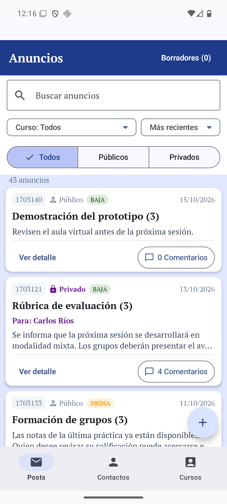
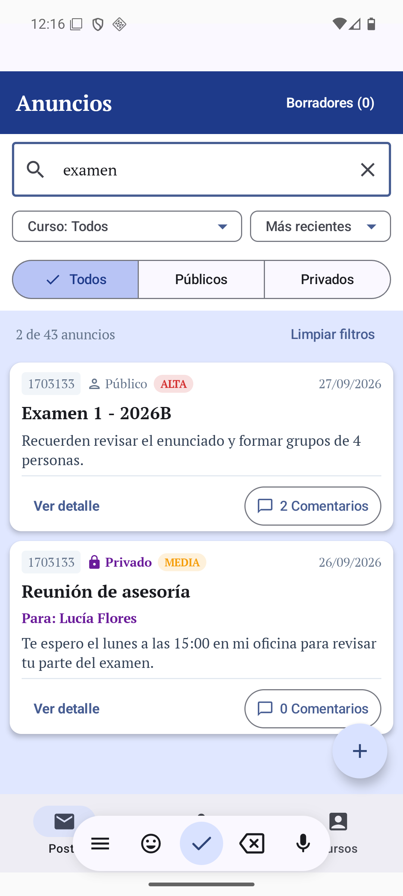
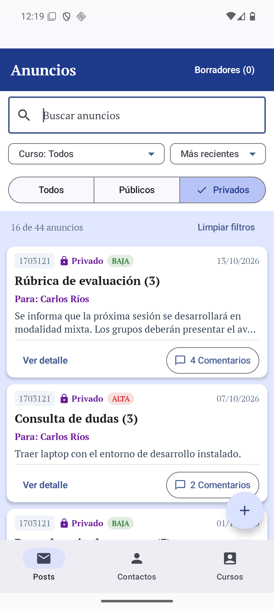
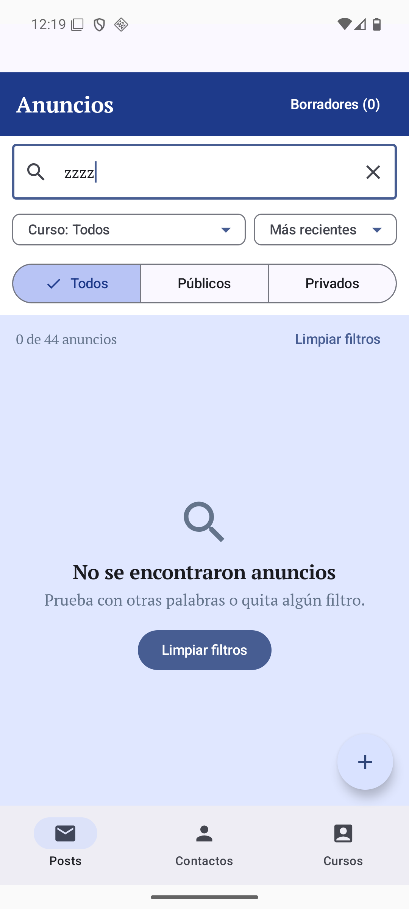
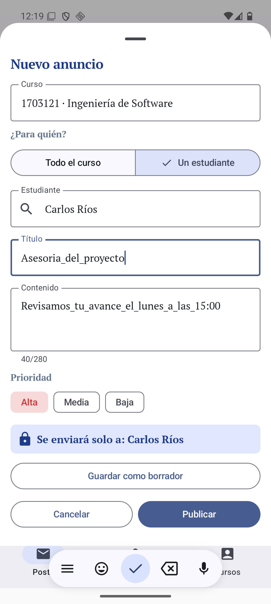
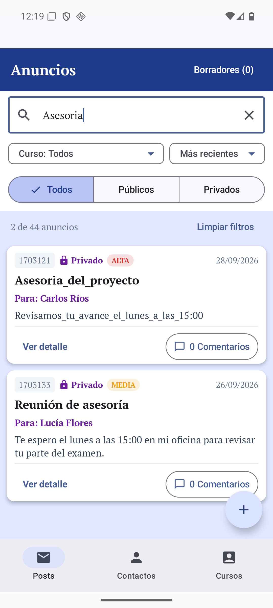
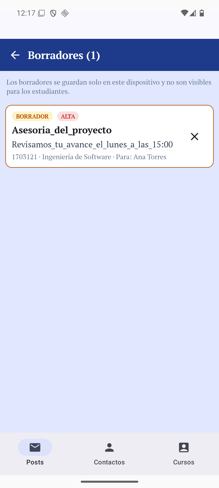
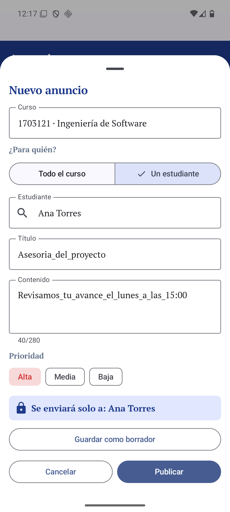
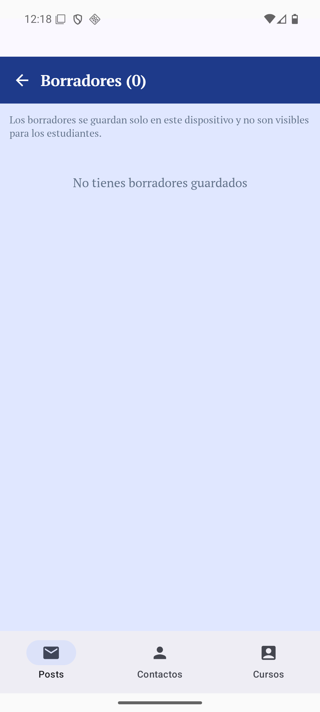

# Proyecto Integrador – Parte 2: Implementación y validación del Muro de Anuncios

Implementación en Jetpack Compose (MVVM) del diseño propuesto en el Examen 2 (Alternativa B del Problema 1 y Alternativa B del Problema 2), sobre la aplicación AlertaUNI entregada por el docente. Código en [`/AlertaUNI`](../AlertaUNI) (rama `proy02-implementacion`).

> Informe con comparativas antes/después y el código de cada cambio: [`informe/INFORME_PROYECTO_2.md`](informe/INFORME_PROYECTO_2.md)

## Qué se implementó

| Tarea | Implementación | Archivos principales |
|---|---|---|
| **1. Interfaz** | Muro compacto con buscador siempre visible, filtros por curso y tipo (Todos/Públicos/Privados), orden (Más recientes / Más antiguos), tarjetas con vista previa y acciones separadas **Ver detalle** y **Comentarios**; pantalla de detalle; formulario único «Nuevo anuncio» (`ModalBottomSheet`) con selector de audiencia | `screen/proposal/Problem2Board.kt`, `screen/proposal/NewAnnouncementSheet.kt`, `screen/post/PostScreen.kt` |
| **2A. Anuncios privados** | Curso → «Un estudiante» → selector con búsqueda → título/contenido/prioridad → resumen «Se enviará solo a: …». El anuncio queda asociado al destinatario y se muestra en el muro como *Privado* con «Para: nombre». También desde Contactos | `NewAnnouncementSheet.kt`, `ContactViewModel.addPostPrivate` |
| **2B. Búsqueda** | Coincidencias parciales en título/contenido (también curso), sin distinguir mayúsculas ni tildes; se actualiza al escribir; mensaje «No se encontraron anuncios» + «Limpiar filtros»; la **X** borra el texto y «Limpiar filtros» vuelve a la lista completa. Los criterios viven en `PostViewModel` (`query`, `course`, `vis`, `sort`) | `PostViewModel.kt`, `applyCriteria()` |
| **3. Borradores (Room)** | «Guardar como borrador» en el formulario; pantalla **Borradores (n)** (tarjetas con etiqueta ámbar *BORRADOR*, separadas del muro); tocar un borrador lo reabre para continuar editando; se eliminan al publicarse o con la X. Persisten tras cerrar la app y **pertenecen a la cuenta** (`ownerKey = correo|rol`), por lo que otra cuenta no los ve | `data/model/DraftEntity.kt`, `data/local/DraftDao.kt`, `data/local/AppDatabase.kt` (v3), `data/repository/DraftRepository.kt`, `screen/post/DraftViewModel.kt` |
| **4A. Datos de prueba** | 43 anuncios (7 base + 36 generados): públicos/privados, prioridad alta/media/baja, fechas de agosto a octubre, títulos y contenidos cortos, medios y largos | `data/demo/DemoRepositories.kt` |

Arquitectura: Compose (UI) → ViewModels Hilt (`PostViewModel`, `DraftViewModel`, `ContactViewModel`) → repositorios (`PostRepository`, `DraftRepository`) → Room / backend. Se conservaron las funcionalidades existentes (login, cursos, contactos, comentarios, notificaciones).

## Real vs. simulado

| Elemento | Estado |
|---|---|
| Borradores, búsqueda, filtros, orden, detalle | **Reales** (Room y estado en ViewModel) |
| Publicar anuncio / enviar privado, lista de anuncios, comentarios, estudiantes | **Simulados**: en esta rama los repositorios de red se reemplazan por repositorios en memoria (`DemoRepositories.kt`, modo demo ya presente en `main`) porque no hay credenciales de Supabase. Los datos se reinician al reiniciar la app |
| Prioridad | Se añadió el campo `priority` al modelo y al formulario, pero las funciones del servidor no se modificaron para guardarlo; solo se persiste en el modo demo |
| Hora de publicación | El modelo solo trae fecha (`dd/MM/yyyy`) |
| Archivado | No implementado |

## Capturas (emulador Android, Pixel 36)

| Muro con 43 anuncios | Búsqueda «examen» | Filtro Privados |
|---|---|---|
|  |  |  |

| Sin resultados | Formulario privado a un estudiante | Anuncio privado publicado («Para: …») |
|---|---|---|
|  |  |  |

| Borrador guardado | Borrador tras cerrar y reabrir la app | Borrador reabierto para editar | Otra cuenta (Estudiante): sin borradores |
|---|---|---|---|
|  |  |  |  |

### Mejoras respecto a la implementación original
- Antes: el buscador no filtraba; ahora filtra por texto y se combina con curso, tipo y orden.
- Antes: tarjetas de 220 dp que recortaban el contenido y un toque abría directamente comentarios; ahora hay vista previa, detalle completo y acceso separado a Comentarios.
- Antes: el envío privado solo existía en Contactos y público/privado en dos formularios; ahora un único formulario con resumen de destinatario y botón «Publicar» deshabilitado hasta completarlo.
- Antes: no había borradores; ahora se guardan en Room por cuenta.

## Decisiones del diseño del examen: qué se mantuvo y qué cambió
- **Se mantuvo:** formulario único con selector de audiencia (`SegmentedButton`), resumen del destinatario, reinicio del estudiante al cambiar de curso, muro compacto con búsqueda visible, tarjeta con acciones separadas, detalle completo, mensaje de vacío con «Limpiar filtros».
- **Cambió:** (1) el orden «Más recientes / Más antiguos» se aplica sobre fechas normalizadas a `aaaaMMdd` porque la API entrega texto `dd/MM/yyyy`; (2) el campo de búsqueda también compara código y nombre del curso (era solo título y contenido) para que escribir «Software» encuentre el curso; (3) se añadió el acceso **Borradores (n)** en la cabecera, pedido por la Tarea 3; (4) los filtros usan `FilterChip` + menús desplegables en filas fijas en vez de `LazyRow`, para que todos los criterios activos queden visibles sin desplazarse.

## Pruebas
**Funcionamiento (43 anuncios):** búsqueda con coincidencia parcial, sin tildes y sin mayúsculas ✔; combinación texto+curso+tipo ✔; sin resultados ✔; orden ✔; publicar al curso y a un estudiante ✔; guardar/reabrir/eliminar borrador ✔; persistencia tras `force-stop` ✔; aislamiento por cuenta (Docente vs Estudiante) ✔; comentarios y navegación existentes ✔.

**Usabilidad (pendiente de completar por el equipo):** la prueba con al menos dos personas ajenas al equipo no puede ser ejecutada por la herramienta. Registrar aquí resultados de: encontrar un anuncio específico, preparar un anuncio privado para un estudiante y guardar/recuperar un borrador (completaron / dificultades / ayuda requerida).

## Cómo ejecutar
```
cd AlertaUNI && gradlew.bat :app:assembleDebug     # requiere local.properties con sdk.dir
```
Entrar con «Entrar como Docente» (modo demo). Alternativas del examen: `adb shell am start -n com.erns.alertauni/.MainActivity --es alt A|C --es p2 A|C`.
