# Informe – Proyecto 2: Implementación del muro de anuncios (AlertaUNI)

Repositorio: https://github.com/RyanValdivia/alertauni-proyecto-integrador-parte2
Base: app AlertaUNI entregada por el docente. Diseño implementado: Examen 2, **Alternativa B del Problema 1** (formulario único) y **Alternativa B del Problema 2** (muro con búsqueda y filtros). Arquitectura: Jetpack Compose + MVVM (Hilt) + Room.

Cada sección sigue el mismo esquema, pensado para una diapositiva: **Antes → Después → Código**.

---

## Comparativas antes → después (listas para las diapositivas)

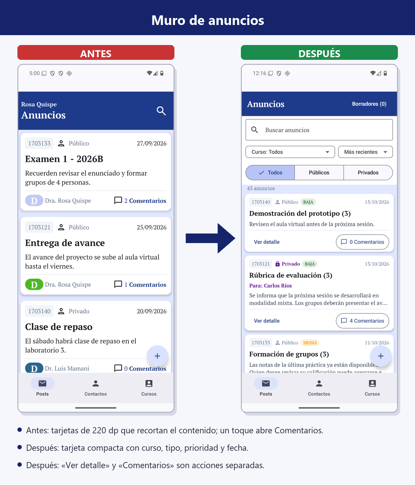
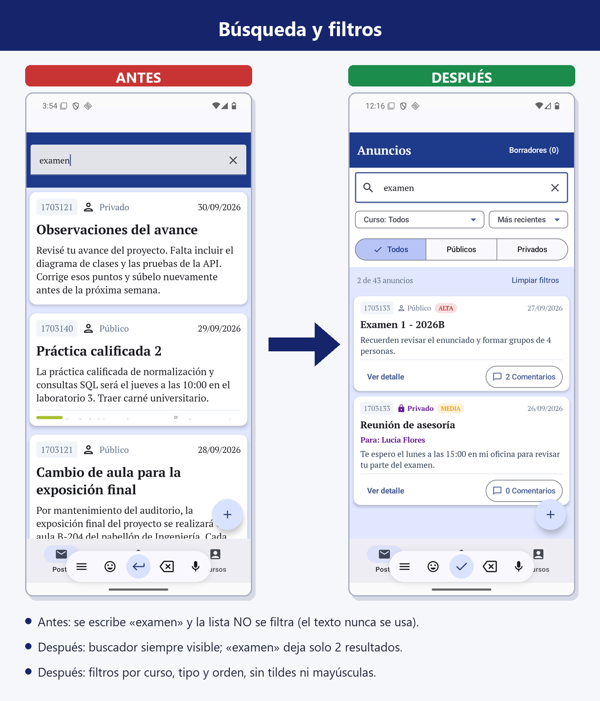
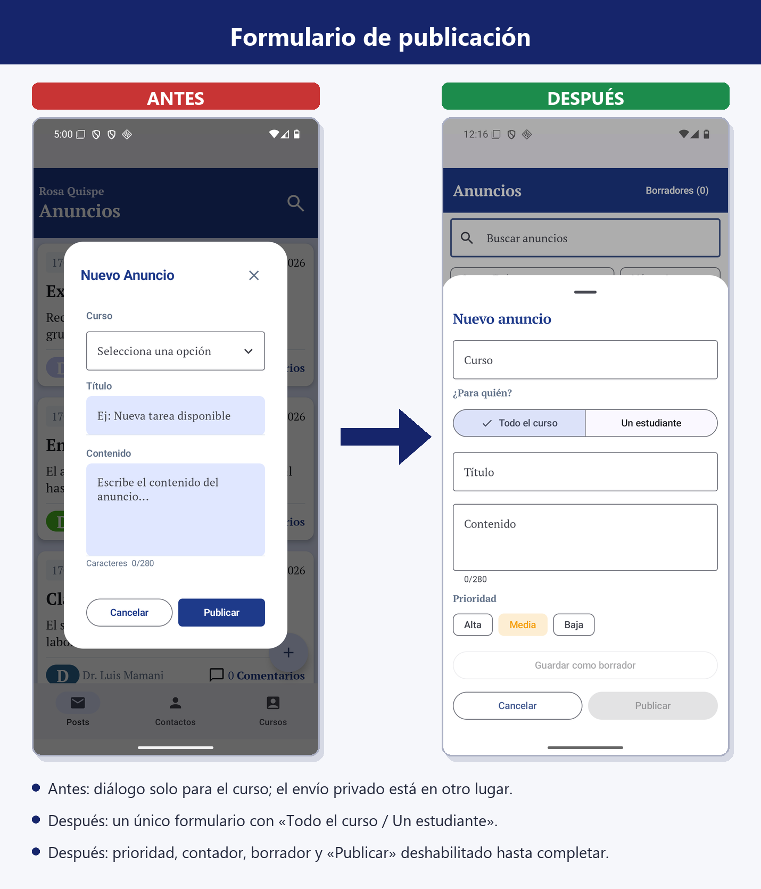
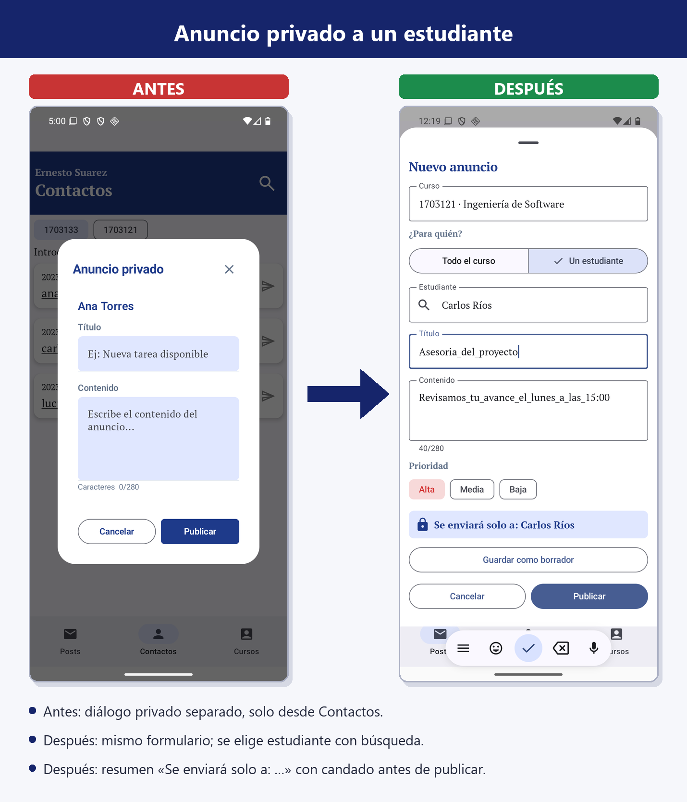
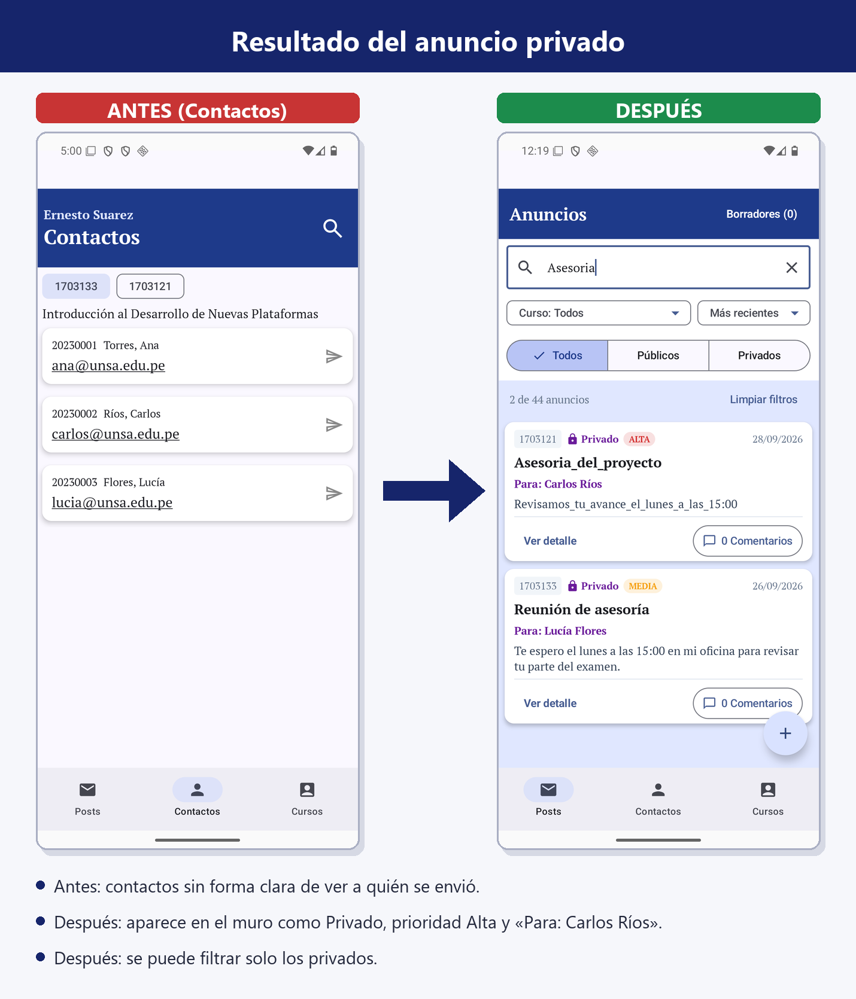
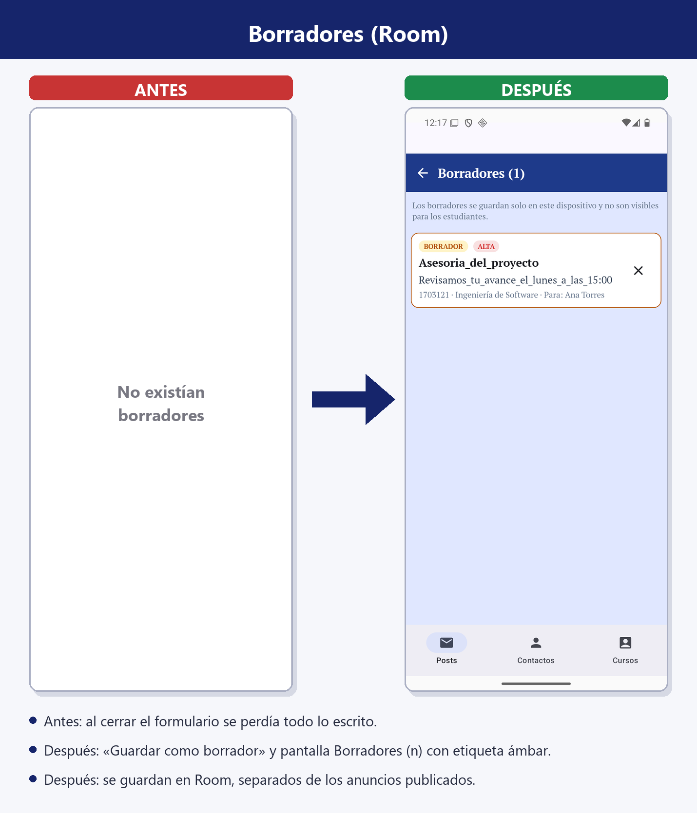
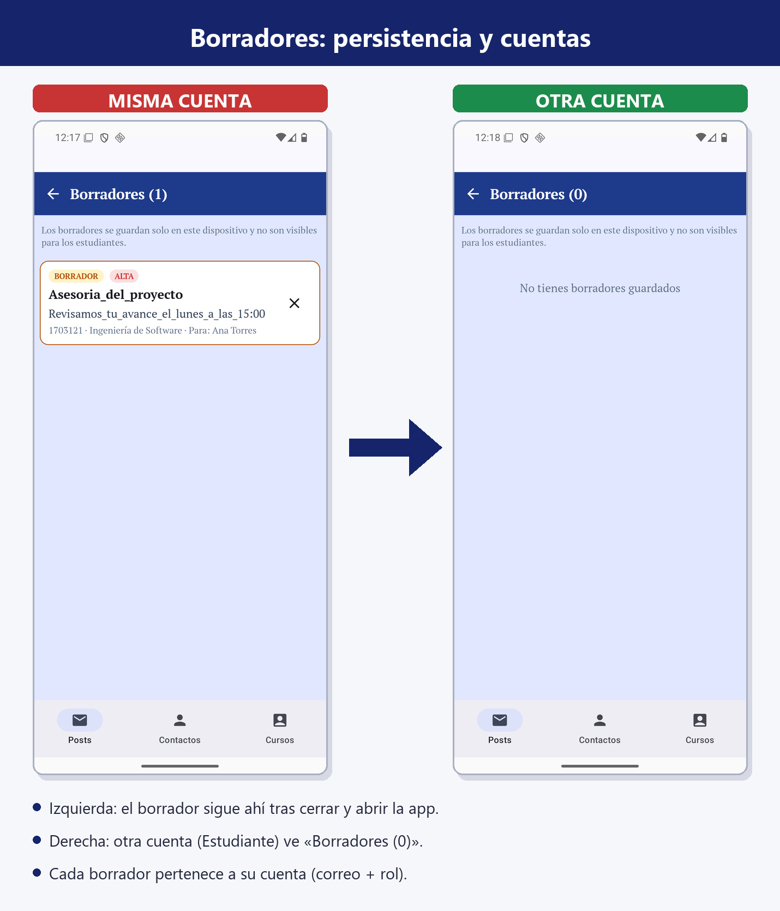

---


## 1. Muro de anuncios (Tarea 1: interfaz)

**Problema original:** las tarjetas miden 220 dp fijos y recortan el contenido; tocar la tarjeta abre directamente Comentarios, así que no hay forma de leer el anuncio completo; no hay filtros ni orden.

| Antes | Después |
|---|---|
| 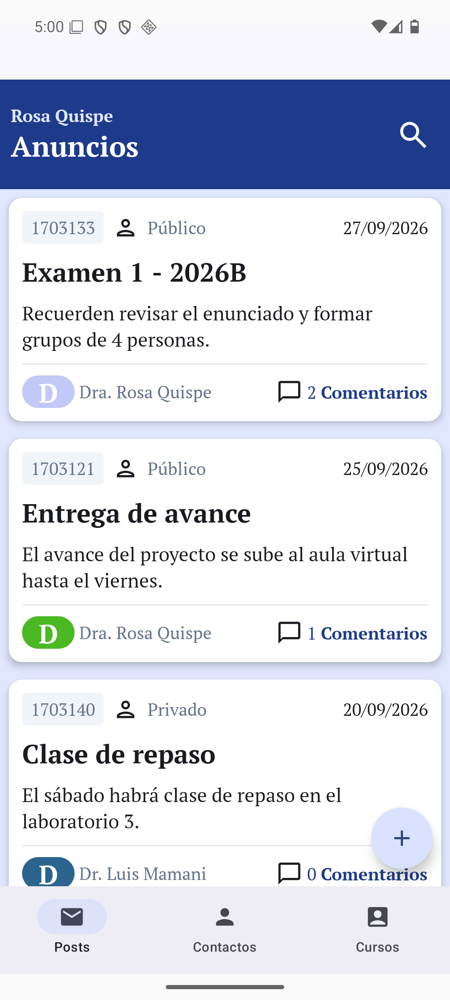 | 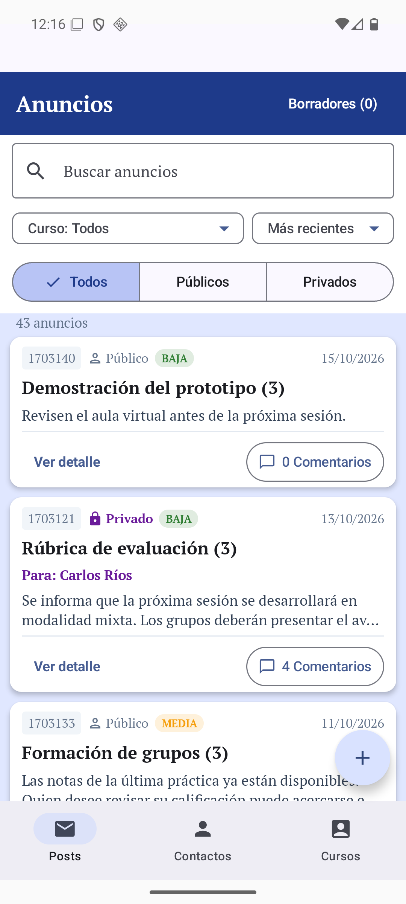 |

**Qué cambió:** tarjeta compacta con código de curso, insignia Público/Privado, prioridad y fecha; título de 1 línea y contenido de 2; acciones separadas «Ver detalle» y «Comentarios».

**Código – antes** (`screen/post/PostScreen.kt`): altura fija y un solo destino al tocar.
```kotlin
Card(
    modifier = Modifier
        .fillMaxWidth()
        .height(220.dp)
        .padding(8.dp)
        .clickable(onClick = { onClickComment(announce.id.toString()) }),
```

**Código – después** (`screen/proposal/Problem2Board.kt`, `CompactCard`): altura según contenido y dos acciones.
```kotlin
Text(post.title, fontSize = 18.sp, fontWeight = FontWeight.Bold, maxLines = 1, overflow = TextOverflow.Ellipsis)
if (post.isPrivate && !post.receiverPrivate.isNullOrBlank()) {
    Text("Para: ${post.receiverPrivate}", color = PRIVATE_COLOR, fontWeight = FontWeight.SemiBold)
}
Text(post.content, maxLines = 2, overflow = TextOverflow.Ellipsis)
Row(Modifier.fillMaxWidth(), verticalAlignment = Alignment.CenterVertically) {
    TextButton(onClick = { onDetail(post) }) { Text("Ver detalle", fontWeight = FontWeight.Bold) }
    Spacer(Modifier.weight(1f))
    OutlinedButton(onClick = { onComments(post) }) { Text("${post.countComments} Comentarios") }
}
```

---

## 2. Búsqueda y filtros (Tarea 2B)

**Problema original:** el cuadro de búsqueda existe pero **no filtra**: guarda el texto en un estado local (`query`) que nunca se usa. En la captura se escribió «examen» y siguen apareciendo anuncios que no lo contienen («Observaciones del avance», «Cambio de aula…»). Además está oculto detrás de un ícono.

| Antes (escribe «examen» y no filtra) | Después («examen» → 2 resultados) |
|---|---|
| 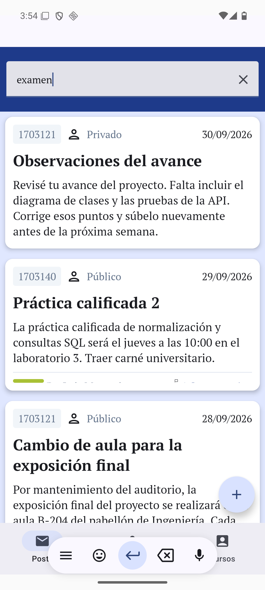 | 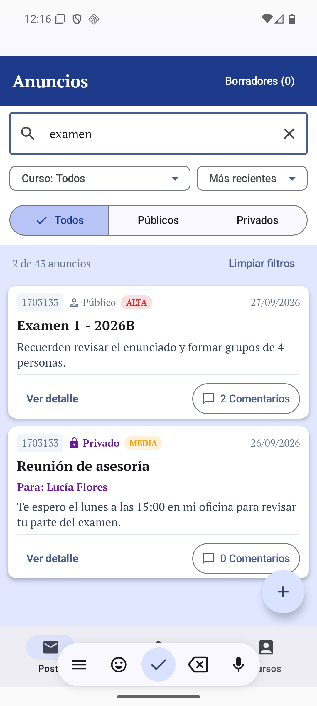 |

**Qué cambió:** buscador siempre visible, filtra al escribir por título, contenido, código y nombre del curso, sin distinguir mayúsculas ni tildes. Se combina con filtros de curso y visibilidad, y con orden por fecha.

**Código – antes** (`screen/common/SearchBoxComponent.kt`): el texto no sale del componente.
```kotlin
val showSearch = remember { mutableStateOf(false) }
val query = remember { mutableStateOf("") }   // nunca se usa para filtrar
```

**Código – después** (criterios en el ViewModel, `screen/post/PostViewModel.kt`):
```kotlin
private val _query = MutableStateFlow("")
val query: StateFlow<String> = _query
private val _course = MutableStateFlow("")
val course: StateFlow<String> = _course
private val _vis = MutableStateFlow("all")      // all | public | private
val vis: StateFlow<String> = _vis
private val _sort = MutableStateFlow("recent")  // recent | oldest
val sort: StateFlow<String> = _sort
fun setQuery(v: String) { _query.value = v }
fun clearFilters() { _query.value = ""; _course.value = ""; _vis.value = "all"; _sort.value = "recent" }
```

**Lógica de filtrado** (`screen/proposal/Problem2Board.kt`):
```kotlin
internal fun applyCriteria(
    posts: List<PostEntity>, query: String, course: String, vis: String, sort: String, from: String, to: String
): List<PostEntity> {
    val q = norm(query.trim())              // quita tildes y pasa a minúsculas
    return posts.filter {
        (q.isEmpty() || norm(it.title).contains(q) || norm(it.content).contains(q) ||
                norm(it.courseCode).contains(q) || norm(it.courseName ?: "").contains(q)) &&
                (course.isEmpty() || it.courseCode == course) &&
                (vis == "all" || (vis == "private") == it.isPrivate)
    }.let { l ->
        when (sort) {
            "oldest" -> l.sortedBy { dateKey(it.date) }
            else -> l.sortedByDescending { dateKey(it.date) }
        }
    }
}
```
Los criterios viven en el ViewModel (no en la pantalla), así que **sobreviven al ir a Comentarios y volver**.

| Filtro «Privados» | Sin resultados |
|---|---|
| 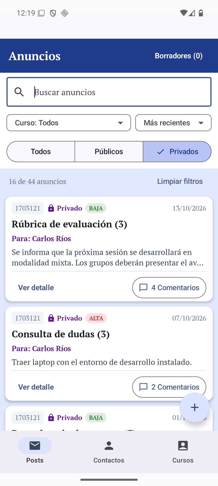 | 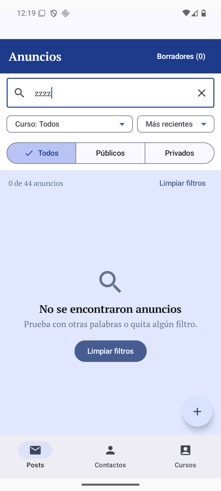 |

Estado vacío (`Problem2Board.kt`): mensaje «No se encontraron anuncios» y botón **Limpiar filtros**.

---

## 3. Formulario único de publicación (Tarea 1 + Problema 1)

**Problema original:** hay dos caminos distintos. Para publicar al curso se usa un diálogo con el botón «+»; para un estudiante hay que ir a Contactos y abrir otro diálogo. Son dos formularios con distinta apariencia y sin resumen de a quién llega el mensaje.

| Antes: diálogo público | Antes: diálogo privado (desde Contactos) |
|---|---|
| 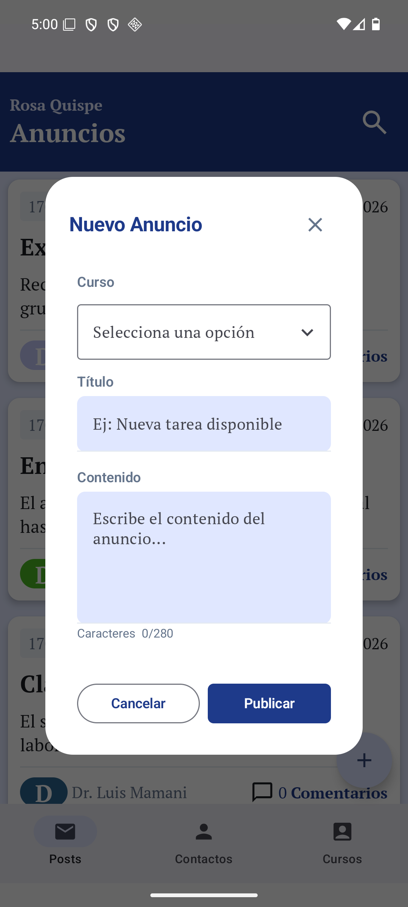 | 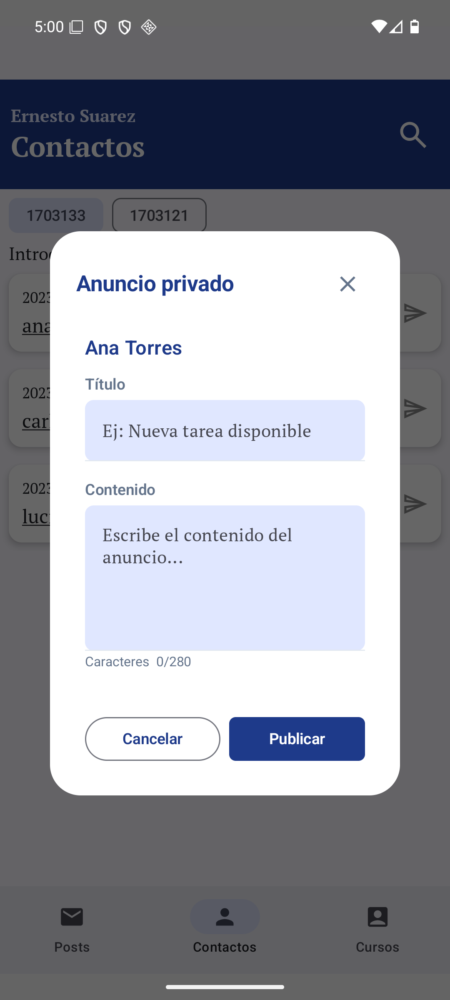 |

**Después:** una sola hoja inferior «Nuevo anuncio» con selector **Todo el curso / Un estudiante**, título, contenido con contador, prioridad y botones. «Publicar» se habilita solo cuando el formulario es válido.

| Después: formulario único (vacío) |
|---|
| 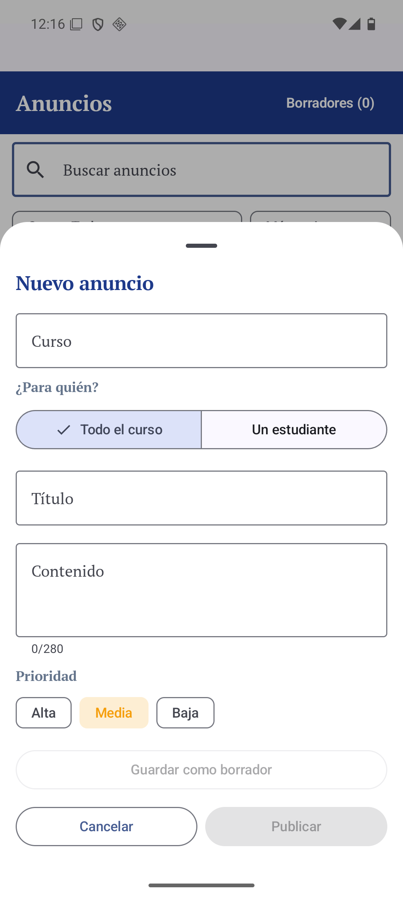 |

**Código** (`screen/proposal/NewAnnouncementSheet.kt`): validación y botón.
```kotlin
val valid = course != null && title.isNotBlank() && content.isNotBlank() &&
        (audience == Audience.COURSE || student != null)
...
Button(
    enabled = valid,
    onClick = {
        val c = course!!
        if (audience == Audience.COURSE) onPublishCourse(c, priority, title, content)
        else onPublishStudent(c, student!!, priority, title, content)
    },
) { Text("Publicar") }
```
Selector de audiencia:
```kotlin
SingleChoiceSegmentedButtonRow(Modifier.fillMaxWidth()) {
    SegmentedButton(selected = audience == Audience.COURSE, ..., shape = SegmentedButtonDefaults.itemShape(0, 2)) { Text("Todo el curso") }
    SegmentedButton(selected = audience == Audience.STUDENT, ..., shape = SegmentedButtonDefaults.itemShape(1, 2)) { Text("Un estudiante") }
}
```

---

## 4. Anuncios privados a un estudiante (Tarea 2A)

**Antes:** el envío privado solo existía en Contactos y no mostraba a quién iba.

| Antes: Contactos |
|---|
| 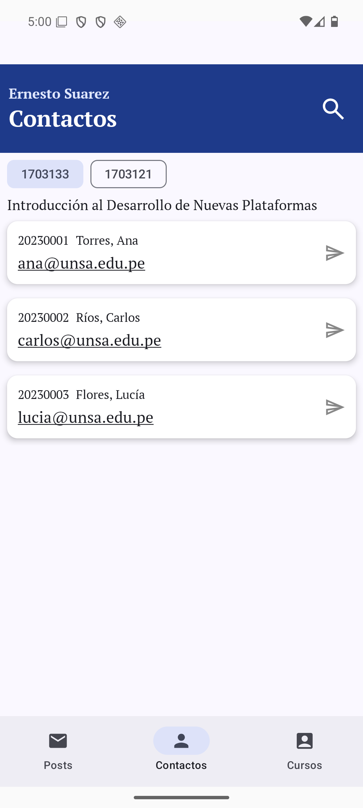 |

**Después:** en el mismo formulario se elige curso → «Un estudiante» → búsqueda por nombre → se muestra un resumen «Se enviará solo a: …» con candado. En el muro aparece como *Privado*, prioridad y **«Para: Carlos Ríos»**.

| Formulario privado | Publicado en el muro |
|---|---|
| 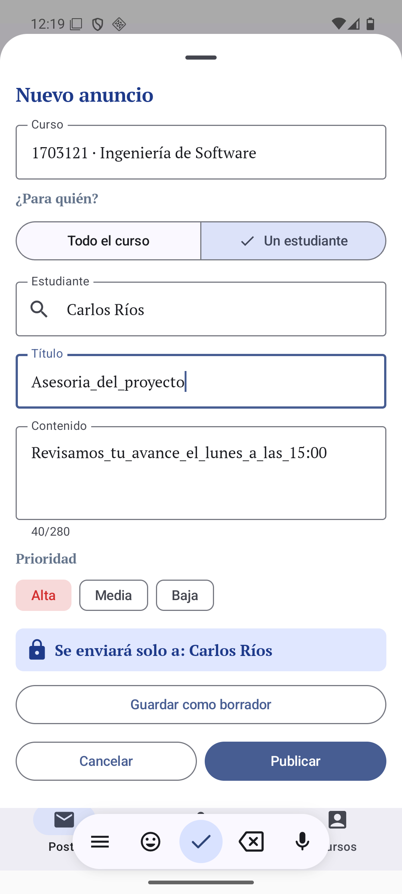 | 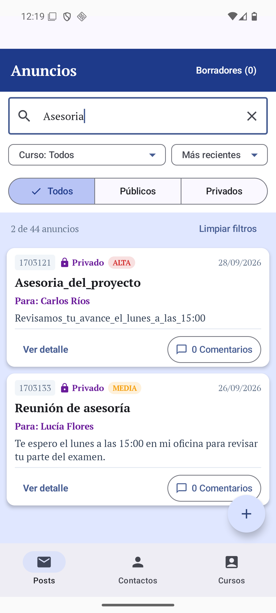 |

**Código – resumen de destinatario** (`NewAnnouncementSheet.kt`):
```kotlin
val to = if (audience == Audience.COURSE) "a los estudiantes de ${c.courseCode}"
else student?.let { "solo a: ${it.firstname} ${it.surname}" } ?: "— elija un estudiante —"
Surface(color = Color(0xFFE0E7FF), shape = RoundedCornerShape(8.dp)) {
    Row(Modifier.fillMaxWidth().padding(10.dp), verticalAlignment = Alignment.CenterVertically) {
        if (audience == Audience.STUDENT) Icon(Icons.Default.Lock, null, tint = MyPrimaryColor)
        Text("Se enviará $to", color = MyPrimaryColor, fontWeight = FontWeight.SemiBold)
    }
}
```

---

## 5. Borradores con Room (Tarea 3)

**Antes:** no existían. Si el docente cerraba el formulario, perdía todo.

**Después:** botón «Guardar como borrador»; pantalla **Borradores (n)** con etiqueta ámbar *BORRADOR*, distinta del muro; tocar uno lo reabre para editar; se borra al publicarse. Persisten tras cerrar la app y pertenecen a la cuenta.

| Borradores guardados | Persiste tras cerrar y abrir la app |
|---|---|
| 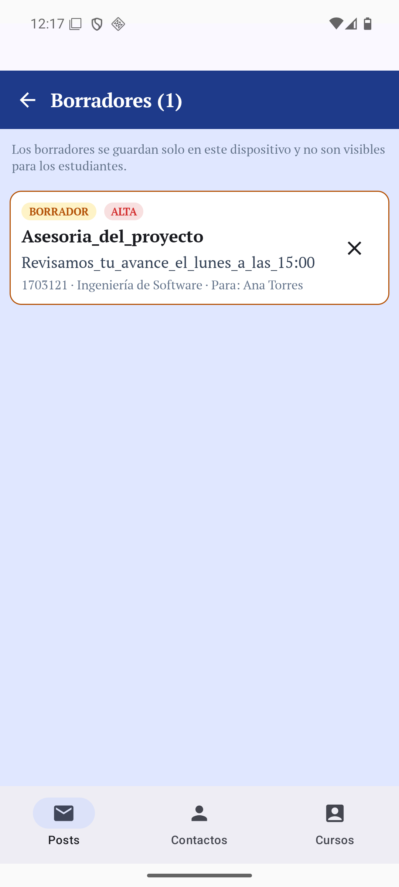 |  |

| Borrador reabierto para editar | Otra cuenta (Estudiante): sin borradores |
|---|---|
| 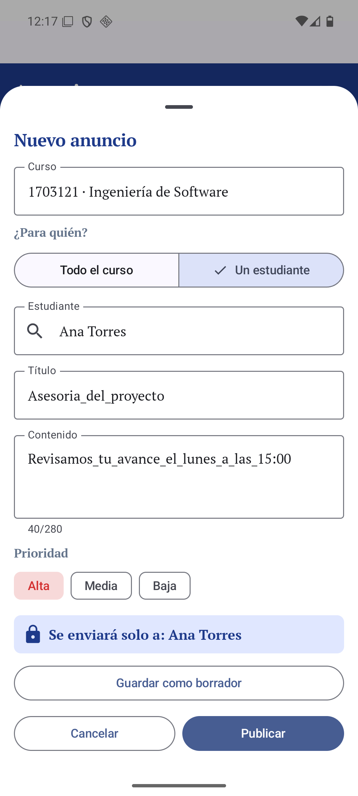 | 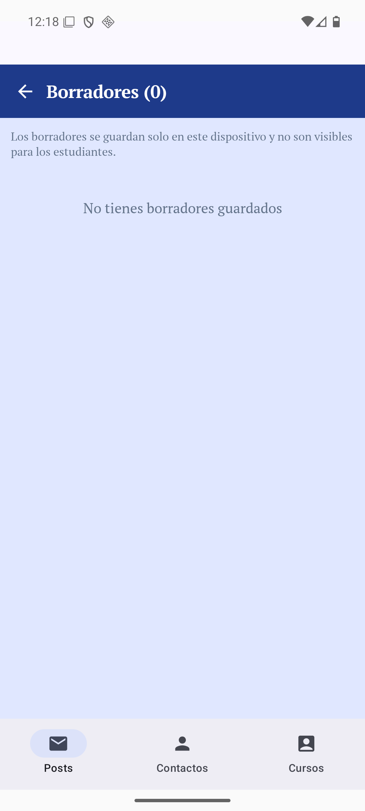 |

**Código – entidad** (`data/model/DraftEntity.kt`):
```kotlin
@Entity(tableName = "drafts")
data class DraftEntity(
    @PrimaryKey(autoGenerate = true) val id: Long = 0,
    val ownerKey: String,
    val courseId: String,
    val audience: String,            // "COURSE" | "STUDENT"
    val studentId: String? = null,
    val studentFirstname: String? = null,
    val studentSurname: String? = null,
    val priority: String = "medium",
    val title: String = "",
    val content: String = "",
    val updatedAt: Long = System.currentTimeMillis()
)
```
**DAO** (`data/local/DraftDao.kt`):
```kotlin
@Insert(onConflict = OnConflictStrategy.REPLACE)
suspend fun upsert(draft: DraftEntity): Long

@Query("SELECT * FROM drafts WHERE ownerKey = :owner ORDER BY updatedAt DESC")
fun observe(owner: String): Flow<List<DraftEntity>>

@Query("DELETE FROM drafts WHERE id = :id AND ownerKey = :owner")
suspend fun delete(id: Long, owner: String)
```
**Repositorio** (`data/repository/DraftRepository.kt`): cada borrador pertenece a la cuenta (correo + rol).
```kotlin
private suspend fun owner(): String = "${dataStore.getEmail()}|${dataStore.getUserType().orEmpty()}"
fun observe(): Flow<List<DraftEntity>> = flow { emit(owner()) }.flatMapLatest { dao.observe(it) }
suspend fun save(draft: DraftEntity) { dao.upsert(draft.copy(ownerKey = owner(), updatedAt = System.currentTimeMillis())) }
```
**ViewModel** (`screen/post/DraftViewModel.kt`):
```kotlin
val drafts: StateFlow<List<DraftEntity>> =
    repository.observe().stateIn(viewModelScope, SharingStarted.Eagerly, emptyList())
fun save(draft: DraftEntity) = viewModelScope.launch { repository.save(draft) }
fun delete(id: Long) = viewModelScope.launch { repository.delete(id) }
```
**Botón en el formulario** (`NewAnnouncementSheet.kt`): se habilita con curso y al menos título o contenido.
```kotlin
val canDraft = course != null && (title.isNotBlank() || content.isNotBlank())
OutlinedButton(enabled = canDraft, onClick = { onSaveDraft(DraftEntity(...)); onDismiss() }) {
    Text("Guardar como borrador")
}
```
La base pasa a versión 3 (`AppDatabase.kt`, entidades `Notificacion` + `Draft`).

---

## 6. Datos de prueba (Tarea 4)

43 anuncios (7 base + 36 generados en `data/demo/DemoRepositories.kt`) con curso, visibilidad (1 de cada 3 es privado), prioridad alta/media/baja, fechas de agosto a octubre y contenido corto, medio y largo.
```kotlin
private fun generatedPosts(): List<PostEntity> {
    ...
    return (0 until 36).map { i ->
        val c = courses[i % 3]
        val body = when (i % 4) { 0 -> short[i % 3]; 1 -> medium[i % 2]; 2 -> long[i % 2]; else -> short[(i + 1) % 3] }
        val priv = i % 3 == 1
        PostEntity(id = 8 + i, ..., isPrivate = priv, priority = priorities[(i / 2) % 3], ...)
    }
}
```

---

## 7. Qué es real y qué es simulado

| Elemento | Estado |
|---|---|
| Borradores (Room), búsqueda, filtros, orden, detalle | **Real** |
| Publicar, enviar privado, lista de anuncios, comentarios, estudiantes | **Simulado**: repositorios en memoria (`DemoRepositories.kt`); se reinician al cerrar la app |
| Prioridad | Se guarda solo en el modo demo (no se modificaron las funciones del servidor) |
| Hora de publicación | No existe: el modelo solo trae fecha |
| Archivado | No implementado |

## 8. Pruebas

**Funcionamiento (43 anuncios), verificado en emulador:** búsqueda parcial sin tildes ni mayúsculas ✔, combinación texto + curso + tipo ✔, sin resultados ✔, orden ✔, publicar al curso y a un estudiante ✔, guardar/reabrir/eliminar borrador ✔, persistencia tras cerrar la app ✔, aislamiento por cuenta ✔, comentarios y navegación existentes ✔.

**Usabilidad con personas ajenas al equipo: PENDIENTE.** Completar antes de exponer:

| Tarea | Persona 1 | Persona 2 |
|---|---|---|
| Encontrar un anuncio concreto | | |
| Preparar un anuncio privado a un estudiante | | |
| Guardar y recuperar un borrador | | |
| Dificultades / ayuda requerida | | |

## 9. Guía para las diapositivas (7 min)

1. **Portada + diseño del examen** (Alt. B Problema 1 y 2) – 1 diapositiva.
2. **Muro: antes/después** (sección 1) – 1 diapositiva.
3. **Búsqueda y filtros: antes/después + `applyCriteria`** (sección 2) – 1 diapositiva.
4. **Formulario único + privado** (secciones 3 y 4) – 1 diapositiva.
5. **Borradores con Room** (sección 5, mostrar la entidad y la captura de persistencia) – 1 diapositiva.
6. **Arquitectura MVVM y real vs. simulado** (sección 7) – 1 diapositiva.
7. **Demo en vivo + pruebas y mejoras futuras** – 1 diapositiva.
